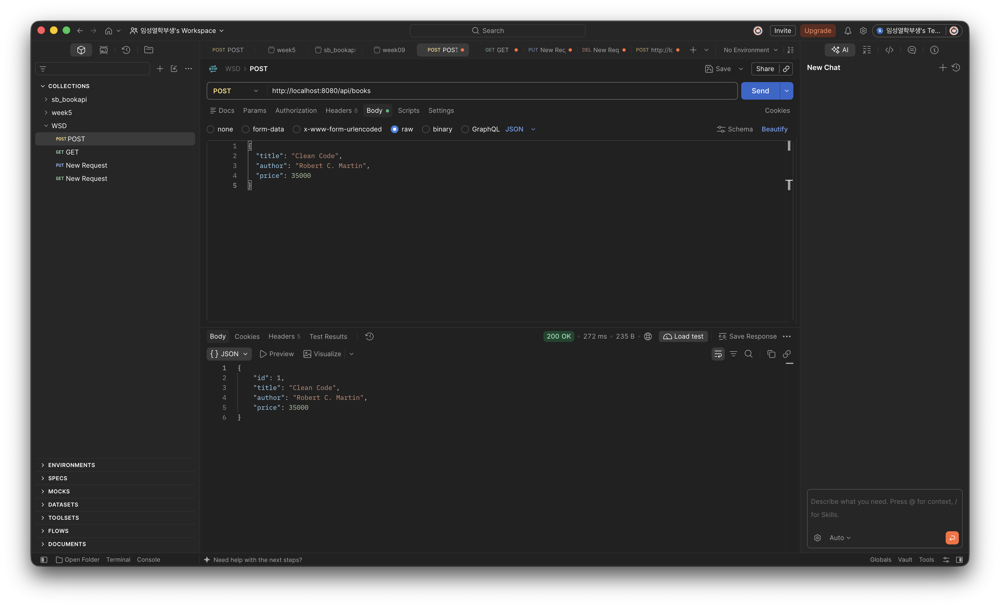
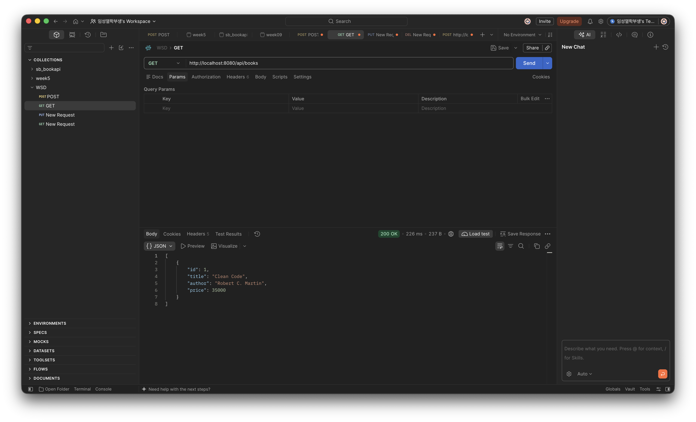
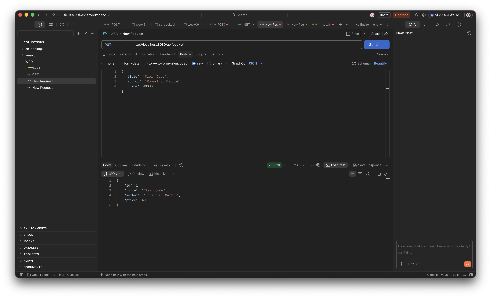
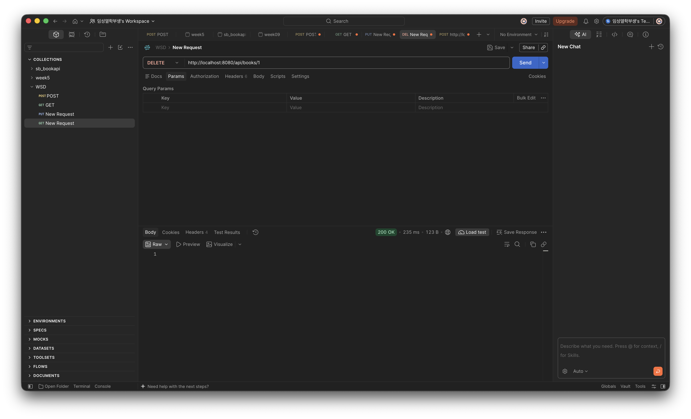
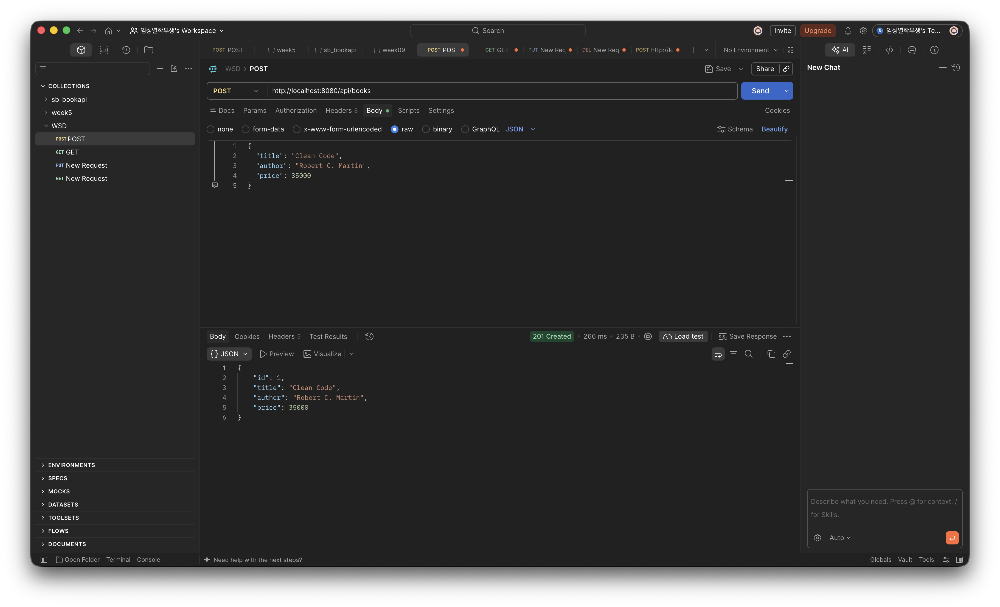
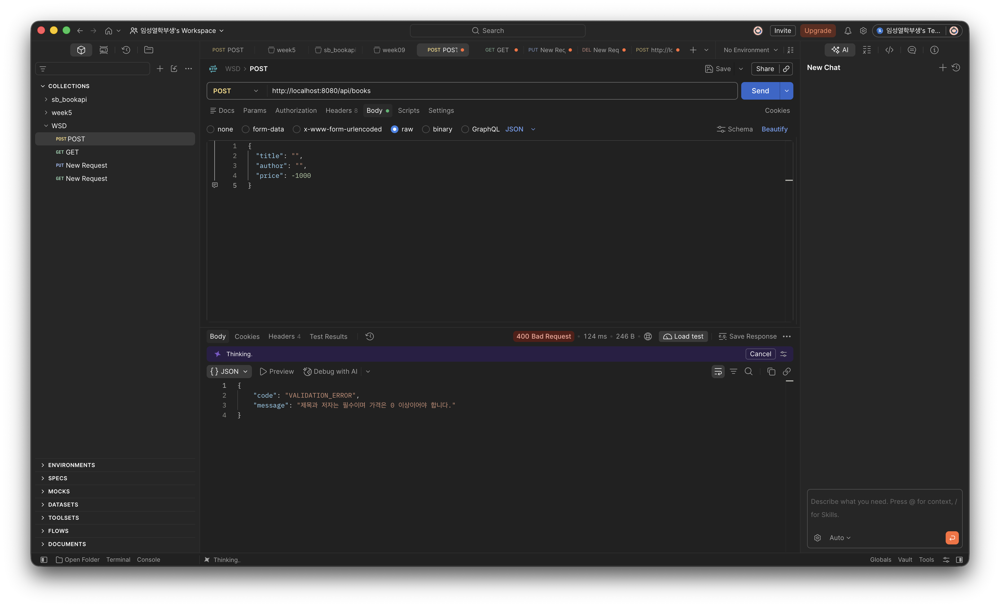
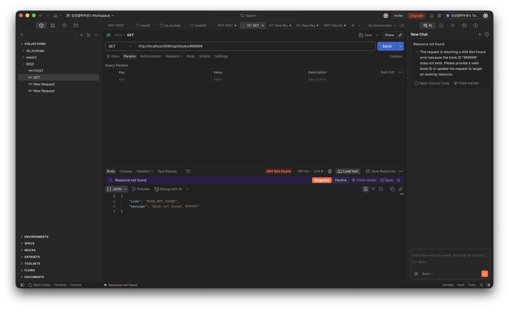
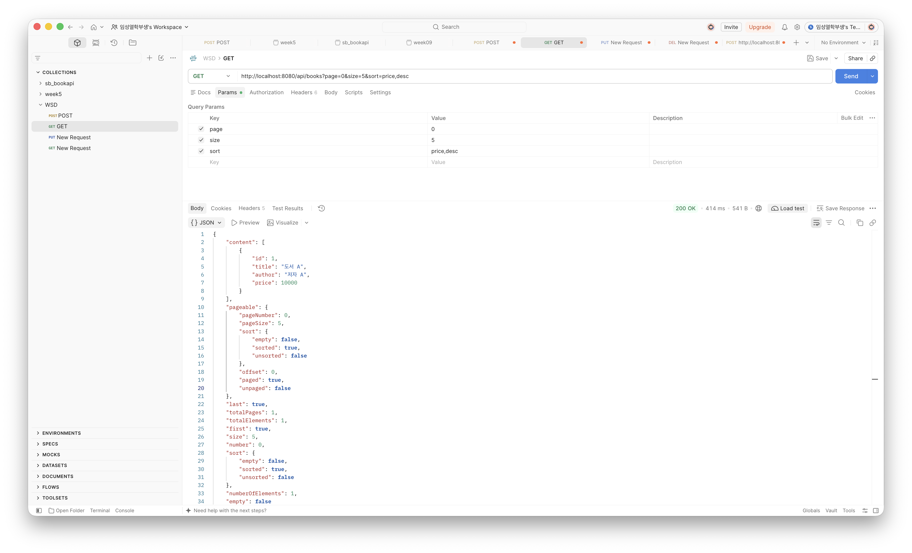
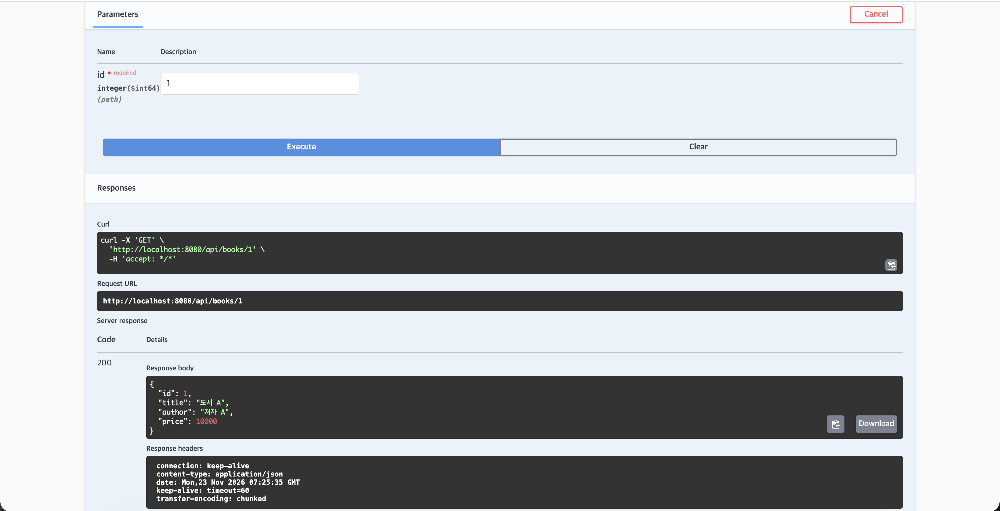

## Week 12 — Spring Boot REST API Advanced Customizing & Deployment 22200619 임성열

## Project Information
### 프로젝트 소개
- Spring Boot와 Spring Data JPA를 사용한 도서 관리 REST API 프로젝트
- 도서 등록·조회·수정·삭제 기능에 DTO, 입력 검증, 공통 예외 처리, 페이지네이션 및 정렬, Swagger API 문서화를 적용
### GitHub URL
- https://github.com/2026-2-WebService/assign12-c01-22200619.git
### Render URL
- https://wsd-week12-sample-project.onrender.com/

## Installation

### Java/DB 환경과 실행 방법
- Java 17
- Spring Boot 3.5.7
- Gradle
- Spring Data JPA
- MariaDB
- Spring Boot Validation
- springdoc-openapi 2.10.0
- 
### 실행 방법

1. 프로젝트를 IntelliJ에서 엽니다.
2. 프로젝트 JDK를 Java 17로 설정합니다.
3. Gradle 프로젝트를 동기화합니다.
4. `Week12Application` 실행 설정에 환경 변수를 입력합니다.
5. `Week12Application`을 실행합니다.

## Source Code Exploration: 분석 질문 8개 답변, 주석 작성한 메서드 3개

### Project Structure & JPA
1. BookController, BookService, BookRepository의 역할과 요청 처리 흐름을 설명하세요.
- BookController는 HTTP 요청을 받아 Service를 호출하고, 응답 데이터와 HTTP 상태 코드를 결정하는 역할을 한다.
- BookService는 도서 생성·수정·조회 등의 처리 과정을 수행하며, BookRepository는 JPA를 통해 DB에 접근하게 된다. 
- 등록 요청은 BookController.create() → BookService.create() → repository.save() 순서로 처리되고 저장된 Book은 Controller에서 BookResponse로 변환되어 반환됩니다.
- 관련 소스: BookController.java의 create(), BookService.java의 create(), BookRepository.java

2. JpaRepository<Book, Long>만 선언해도 findAll(), save()를 사용할 수 있는 이유를 설명하세요.
- JpaRepository는 조회·저장·삭제 등에 필요한 메서드가 이미 정의되어 있다. 
- Spring Data JPA는 애플리케이션 실행 시 Repository 프록시를 생성하고, 기본 구현을 연결하므로 개발자가 각 메서드를 직접 구현하지 않아도 된다. 
- 관련 소스: BookRepository.java의 인터페이스 선언, BookService.java의 findAll()·create().

### DTO & HTTP Response
3. 기존 API가 Book Entity를 직접 요청·응답에 사용할 때 발생할 수 있는 문제를 설명하세요.
- Entity를 요청 데이터로 직접 받으면 서버가 관리해야 할 필드까지 입력 대상으로 노출될 수 있다. 
- 응답으로 직접 반환하면 API에 필요하지 않은 필드가 노출되거나, Entity 변경이 응답 구조에 영향을 줄 수 있다. 
- 관련 소스: Book.java의 필드, 초기 BookController.java의 create()·get().

4. Request DTO와 Response DTO를 분리하는 이유와 ResponseEntity가 필요한 상황을 설명하세요.
- Request DTO와 Response DTO를 분리하면 클라이언트가 입력할 데이터와 서버가 반환할 데이터를 각각 정할 수 있다.
- ResponseEntity는 응답 본문뿐 아니라 상태 코드와 헤더를 제어할 때 사용하며, 현재 등록의 201 Created와 삭제의 204 No Content 응답에 활용된다.
- 관련 소스: BookRequest.java, BookResponse.java의 from(), BookController.java의 create()·delete().

### Validation & Exception Handling
5. @Valid, @NotBlank, @Min은 각각 어느 시점에 어떤 동작을 수행하나요?
- 요청 JSON이 BookRequest로 변환하고 Controller 메서드 본문이 실행되기 전에 @Valid를 통해 DTO에 선언한 검증 조건을 검사한다. 
- @NotBlank는 제목과 저자가 null, 빈 문자열 또는 공백으로만 이루어졌는지 검사하고 @Min(0)은 가격이 0 이상인지 검사한다. 
- 검증에 실패하면 MethodArgumentNotValidException이 발생하며 이를 400 응답을 반환한다.
- 관련 소스: BookRequest.java, BookController.java의 create()·update(), GlobalExceptionHandler.java의 handleValidation().

6. @RestControllerAdvice와 @ExceptionHandler를 사용하면 예외 처리 흐름이 어떻게 바뀌나요?
- 각 Controller에서 예외를 개별적으로 처리하는 대신, @RestControllerAdvice가 적용된 클래스에서 여러 Controller의 예외를 공통으로 처리한다
- 관련 소스: BookService.java의 findById(), GlobalExceptionHandler.java의 handleNotFound()·handleValidation(), ApiError.java

### Pagination & OpenAPI
7. Pageable과 Page<T>는 각각 어떤 역할을 하며 sort=price,desc는 어떻게 처리되나요?
- Pageable은 요청의 페이지 번호, 페이지 크기, 정렬 조건을 전달하는 객체이다. 
- Page<T>는 조회된 데이터와 전체 데이터 수, 전체 페이지 수 등의 정보를 함께 제공하는 조회 결과이다. 
- sort=price,desc는 가격 내림차순 정렬 조건으로 해석되어 Repository에 전달되고 DB 조회에 반영된다. 
- 관련 소스: BookController.java의 list(), BookService.java의 findAll().
 
8. /v3/api-docs와 /swagger-ui.html의 역할을 구분해서 설명하세요.
- /v3/api-docs는 API 경로, 요청·응답 구조 등을 OpenAPI 형식의 JSON 문서로 제공합니다. 
- /swagger-ui.html은 이 명세를 사람이 보기 편한 화면으로 표시하고, 브라우저에서 API 요청을 실행할 수 있게 합니다. 
- 관련 소스: build.gradle, BookController.java의 클래스 선언과 list()·get().

### 줄 단위 설명 주석 작성 대상

| 파일 | 메서드 | 과제에서 요구하는 설명 범위 |
|---|---|---|
| BookController.java | create() | @Valid, 요청·응답 DTO, ResponseEntity, 201 응답 |
| BookService.java | findById() | Repository 조회, Optional, 조회 실패 시 예외와 404 처리 |
| BookService.java | findAll() | Pageable, Page, 응답 DTO 변환 |

## Refactoring: DTO와 ResponseEntity 변경 전/후
### 변경 전
- 기존 API는 Book Entity를 Controller의 요청과 응답에 직접 사용했다.
- 이 구조에서는 DB 저장을 위한 Entity와 API의 데이터 구조가 연결되어, Entity의 필드를 변경하면 요청·응답 구조에도 영향을 줄 수 있었다.

### 변경 후

- 요청에는 BookRequest를 사용하여 title, author, price를 받도록 하고, 서버에서 생성하는 id는 요청 DTO의 필드에서 제외했다.
- 응답에는 BookResponse를 사용하여 id, title, author, price를 반환하도록 했다.
- 저장하거나 조회한 Book Entity는 BookResponse.from()을 통해 응답 DTO로 변환한다.

- Controller에는 ResponseEntity를 적용하여 응답 본문과 HTTP 상태 코드를 지정했다.
- 등록 성공 시에는 201 Created, 조회·수정 성공 시에는 200 OK를 반환하고, 삭제 성공 시에는 본문 없이 204 No Content를 반환한다.

## New Features: Validation, 공통 예외 처리, Pagination/Sorting, Swagger

### 1. Validation

BookRequest에 검증 조건을 추가하고, Controller의 등록·수정 메서드에 @Valid를 적용했다.

- title: @NotBlank로 null, 빈 문자열, 공백만 있는 입력을 제한한다.
- author: @NotBlank로 null, 빈 문자열, 공백만 있는 입력을 제한한다.
- price: @Min(0)으로 음수 가격을 제한한다.

검증에 실패하면 400 Bad Request와 오류 정보를 반환한다.

```json
{
  "code": "VALIDATION_ERROR",
  "message": "제목과 저자는 필수이며 가격은 0 이상이어야 합니다."
}
```

### 2. 공통 예외 처리

GlobalExceptionHandler에 @RestControllerAdvice를 적용하고, @ExceptionHandler로 예외 종류에 따른 응답을 처리했다.
오류 응답은 ApiError를 사용하여 code, message 필드를 포함하도록 구현했다.

| 발생 상황 | 예외                               | 상태 코드 | 오류 코드 |
|---|----------------------------------|---|---|
| 존재하지 않는 도서 조회·수정·삭제 | BookNotFoundException            | 404 | BOOK_NOT_FOUND |
| 요청 DTO 검증 실패 | MethodArgumentNotValidException  | 400 | VALIDATION_ERROR |

BookService.findById()에서 조회 결과가 없으면 BookNotFoundException을 발생시킨다.
수정과 삭제에서도 findById()를 호출하여 도서의 존재 여부를 확인한다.

현재 사용자 정의 공통 처리 대상은 위 두 예외이며, JSON 문법 오류에 대한 별도 공통 처리기는 구현하지 않았다.

### 3. Pagination / Sorting

목록 조회에 Pageable을 적용하여 페이지 번호, 페이지 크기, 정렬 조건을 전달받도록 했다.

```text
GET /api/books?page=0&size=5&sort=price,desc
```

| 파라미터 | 의미 |
|---|---|
| page=0 | 첫 번째 페이지 조회 |
| size=5 | 페이지당 최대 5개 조회 |
| sort=price,desc | 가격 기준 내림차순 정렬 |

페이지 크기를 지정하지 않으면 기본값은 10이다.
Repository에서 조회한 Page<Book>은 map(BookResponse::from)으로 변환하여 Page<BookResponse>로 반환한다.

응답에는 도서 목록인 content와 함께 totalElements, totalPages, size, number 등의 페이지 정보가 포함된다.

### 4. Swagger / OpenAPI

springdoc-openapi를 추가하여 API 문서와 테스트 화면을 제공하도록 설정했다.

- /swagger-ui.html: API 문서 확인 및 요청 실행 화면
- /v3/api-docs: OpenAPI 형식의 JSON 명세

BookController에 @Tag를 적용하고, 목록 조회와 단건 조회에 @Operation을 사용하여 설명을 추가했다.

## Testing & Deployment: results/ 스크린샷 6장 이상 및 배포 URL

### 1. 테스트 항목

| 테스트 항목 | 기대 결과 |
|---|---|
| 도서 등록 | 201 Created 및 등록된 도서 응답 |
| 도서 목록·단건 조회 | 200 OK 및 조회 결과 |
| 도서 수정 | 200 OK 및 수정된 도서 응답 |
| 도서 삭제 | 204 No Content, 응답 본문 없음 |
| 빈 제목·저자 또는 음수 가격 입력 | 400 Bad Request |
| 존재하지 않는 도서 조회·수정·삭제 | 404 Not Found |
| 페이지네이션·정렬 요청 | 페이지 정보 및 지정한 순서의 도서 목록 |
| Swagger UI 접속 | API 목록과 요청 실행 화면 표시 |

### 2. 테스트 스크린샷

#### 01. 초기 Sample CRUD 테스트

**도서 등록**



**도서 조회**



**도서 수정**



**도서 삭제**



#### 02. DTO 적용 후 POST 요청



#### 03. Validation 오류 요청



#### 04. 존재하지 않는 ID 요청



#### 05. 페이지네이션 및 정렬



#### 06. Swagger UI




## Weekly Review

### 1. 새롭게 배운 내용 3가지

1. **DTO와 HTTP 상태 코드**
- 요청과 응답에 각각 DTO를 사용하여 클라이언트가 입력하는 데이터와 서버가 반환하는 데이터를 구분하는 방법을 배웠다.
- 또한 ResponseEntity를 사용하면 등록 성공은 201, 삭제 성공은 204처럼 처리 결과에 맞는 상태 코드를 반환할 수 있다는 것을 알게 되었다.

2. **입력 검증과 공통 예외 처리**
- @Valid와 @NotBlank, @Min을 사용해 요청 데이터를 검증하는 방법을 배웠다. 
- @RestControllerAdvice와 @ExceptionHandler를 사용하면 검증 실패나 존재하지 않는 도서에 대한 예외를 공통된 형식으로 처리할 수 있다는 것을 알게 되었다.

3. **페이지네이션과 API 문서화**
- Pageable로 페이지 번호, 크기, 정렬 조건을 전달하고 Page로 조회 결과와 페이지 정보를 함께 반환하는 방법을 배웠다. 
- Swagger UI에서는 API의 요청·응답 구조를 확인하고 직접 요청을 실행할 수 있다는 것을 알게 되었다.

### 2. 어려웠던 점과 해결 방법
- Swagger를 설정하는 방법이 어려운 부분이 있었다.
- 애플리케이션을 실행하고 /swagger-ui.html에 접속했지만, Swagger 화면 대신 404 Whitelabel Error Page가 나타났다.
- dependency는 올바르게 수정했지만 새로고침이 진행되지 않아 해당 문제가 발생하였다.
- 이 과정에서 애플리케이션이 실행되는 것과 Swagger 관련 설정이 정상적으로 적용되는 것은 별도로 확인해야 한다는 점을 알게 되었다.

### 3. AI 활용 내용 및 느낀 점
- AI에 DTO와 Entity의 차이를 질문하면서, Entity는 DB에 저장할 데이터를 표현하고 DTO는 API에서 주고받을 데이터를 정의한다는 점을 알아볼 수 있었다. 
- 특히 BookRequest에는 title, author, price만 선언하고 BookResponse에는 id까지 포함하는 코드를 이해 하는 과정에서 요청과 응답에 필요한 필드를 각각 정하는 이유를 이해하는 데 도움을 받았다.
- 이 과정에서 같은 도서 데이터라도 클라이언트가 입력하는 정보와 서버가 반환하는 정보는 다를 수 있다는 점을 알게 되었다. 
- 특히 id는 서버에서 생성하므로 요청 DTO에서는 제외하고, 응답 DTO에는 포함하여 생성된 도서를 식별할 수 있도록 한다는 점이 이해에 도움이 되었다. 
- 단순히 코드를 따라 작성하는 것보다 각 필드가 필요한 이유를 생각하며 구현하는 것이 중요하다고 느꼈다.
